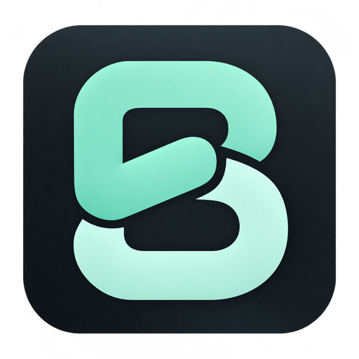
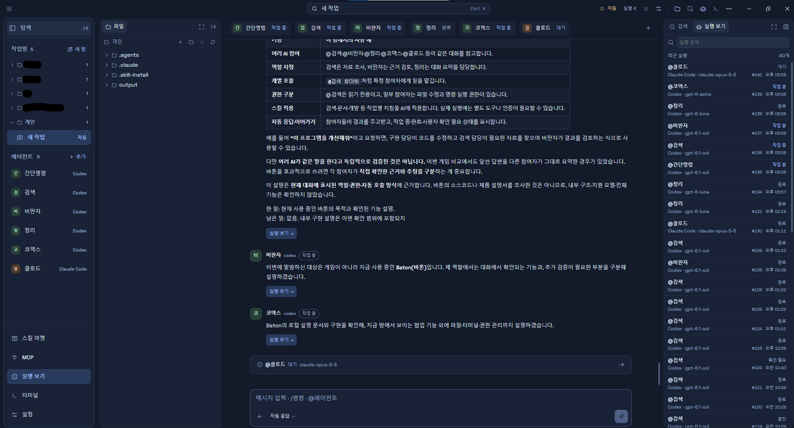

  
  <h1>Baton</h1>
  
<strong>여러 AI에게 한 프로젝트를 맡기고, 바뀐 파일까지 같은 창에서 확인하는 Windows 작업실</strong>

  
<a href="https://github.com/JellyDuke/Baton-Releases/releases/latest"><strong>Windows x64 다운로드</strong></a> · <a href="GETTING_STARTED.md">처음 시작하기</a> · <a href="https://github.com/JellyDuke/Baton-Releases/releases">버전별 변경 사항</a>

  

## 한 작업방에서 구현과 검토 맡기기

Baton에서는 같은 프로젝트 폴더를 여러 AI가 함께 사용합니다. 예를 들어 `구현` 에이전트에는 파일 수정 권한과 프로젝트의 코딩 스킬을, `검토` 에이전트에는 읽기 전용 권한과 검토 지침을 줄 수 있습니다. 모델과 MCP 도구도 에이전트마다 고릅니다.

> 검색창에서 Enter를 두 번 누르면 같은 결과가 두 번 추가돼. 구현 담당은 원인을 찾아 고치고, 검토 담당은 빈 입력과 연속 입력도 확인해 줘.

방 설정에서 **이 방에서 자동 대화 허용**을 켜고 채팅의 **자동 응답**으로 보내면 참여자들이 한 요청을 나눠 맡을 수 있습니다. 한 명에게 먼저 맡길 때는 `@구현`처럼 이름을 지정합니다. 수정이 끝나면 **실행 보기 → 변경 파일**에서 전후 차이를 열고, 이어서 검토를 요청할 수 있습니다.

동시에 진행할 작업 수는 **설정 → 실행 → 동시 AI 실행 수**에서 정합니다. 한도를 넘는 작업은 대기열에서 기다립니다. 같은 폴더에서도 각 에이전트는 설정한 권한으로 실행되며, 두 에이전트의 쓰기 작업이 겹친 경우에는 실행별 되돌리기가 제한됩니다.

Baton은 Windows의 WebView2를 사용합니다. 여러 Codex 에이전트는 하나의 CLI 연결을 공유하고, 마지막 작업 뒤 연결이 유휴 상태가 되면 정리합니다.

## 작업실에서 할 수 있는 일

| 하고 싶은 일 | 어디에서 어떻게 하는지 |
| --- | --- |
| 코드 구조 파악 | **코드 지도**에서 파일·함수 블록을 선택하거나 연결 수로 항목을 좁힙니다. 분석할 AI를 고르고 **선택 항목 분석**을 누르면 역할 설명이 저장됩니다. 다음에 블록을 눌렀을 때 오른쪽에서 다시 읽을 수 있습니다. |
| 작업 결과 검토 | **파일 탐색기**에서 코드·문서를 열어 직접 편집하고 이미지·PDF를 미리 봅니다. 채팅 사진은 클릭해 확대하고 **이미지 복사**로 다른 곳에 붙여 넣을 수 있습니다. |
| 변경 사항 반영 | **Git**에서 바뀐 파일의 차이를 보고 커밋할 파일을 선택합니다. 브랜치 전환, Pull, Push도 같은 패널에서 진행합니다. |
| 명령 실행과 웹 확인 | **터미널**을 분할해 작업 명령과 출력을 나란히 봅니다. **웹** 패널에서는 설치된 Google Chrome으로 페이지를 열 수 있습니다. |
| AI 도구 관리 | 에이전트별로 사용할 **스킬·MCP**를 고릅니다. **플러그인** 화면에서는 Codex와 Claude Code에 설치한 항목부터 보고, **설치 가능**이나 **전체**를 선택하면 마켓 목록을 불러옵니다. |

## 설치하고 첫 요청 보내기

1. **Windows x64용 설치 파일** `Baton_…_x64-setup.exe`를 내려받아 실행합니다. [최신 릴리스](https://github.com/JellyDuke/Baton-Releases/releases/latest)
2. 사용할 AI의 CLI를 준비하고 **설정 → AI 연결**에서 설치·로그인 상태를 확인합니다. 연결 대상은 **Claude Code, Codex CLI, Antigravity CLI, Qwen Code, OpenCode**입니다. OpenCode 연결은 1.x 기준입니다. 사용할 수 있는 모델·권한·도구와 이용 요금은 공급자마다 다릅니다.
3. **에이전트**에서 이름·모델·역할을 정하고, 작업할 폴더로 **작업방**을 만들어 초대합니다. 예를 들어 이름을 `검토`로 지었다면 채팅에 `@검토 이 프로젝트의 시작 파일을 찾아줘`라고 보내 보세요.

Git 패널과 실행 전후 변경 기록·되돌리기를 쓰려면 Git이 필요합니다. 설치한 앱의 업데이트는 **설정 → 업데이트 → 업데이트 확인**에서 받습니다. [처음 시작하기](GETTING_STARTED.md)

## 데이터와 사용 조건

대화·설정은 PC의 SQLite에, 첨부 파일과 실행 스냅샷은 앱 데이터 폴더에 저장합니다. **설정 → 저장 위치**에서 경로를 확인할 수 있습니다. AI에 요청하면 입력·첨부·관련 대화와 도구가 읽는 자료가 연결한 공급자나 서비스로 전달될 수 있습니다. [데이터와 외부 연결 안내](DATA_AND_CONNECTIONS.md)

Baton은 **개인·업무용 무료**입니다. 회사 업무와 유상 의뢰에도 사용할 수 있습니다. 각 기기에서 공식 설치 파일을 받고, 다른 사람에게는 다운로드 링크를 공유해 주세요. 라이선스는 설치 파일의 재배포와 보호되는 코드·자산을 추출·복제해 다른 제품에 재사용하거나 클론을 만드는 행위를 금지합니다. [사용 라이선스](https://github.com/JellyDuke/Baton-Releases/blob/main/LICENSE) · [저작권·브랜드](https://github.com/JellyDuke/Baton-Releases/blob/main/COPYRIGHT.md) · [제3자 고지](https://github.com/JellyDuke/Baton-Releases/blob/main/THIRD_PARTY_NOTICES.md)

문제를 제보할 때는 Baton 버전, 사용한 CLI, 재현 순서와 오류 문구를 알려 주세요. [오류 제보·기능 제안](https://github.com/JellyDuke/Baton-Releases/issues)

Copyright © 2026 JellyDuke. 외부 제품의 이름과 상표는 각 권리자에게 있습니다.
