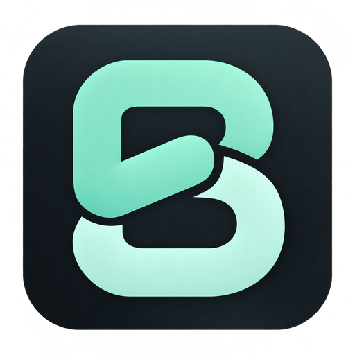
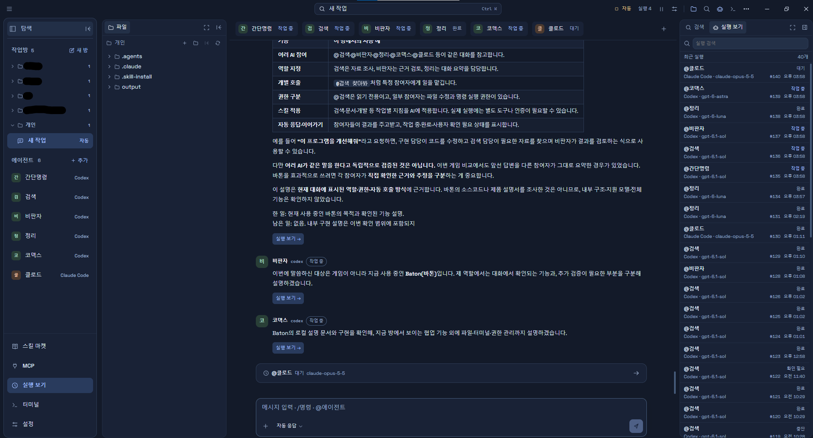

  
  <h1>Baton</h1>
  
<strong>내가 구성한 AI 팀에 한 번에 요청하고, 결과 파일까지 바로 확인하세요.</strong>

  
여러 에이전트의 동시 작업 · 에이전트별 스킬 · 작업실 안의 파일 확인 가벼운 구성을 지향하는 Windows AI 협업 작업실

  

    
    
    
    
  

  
<a href="https://github.com/JellyDuke/Baton-Releases/releases/latest"><strong>Windows 다운로드</strong></a> · <a href="#baton의-핵심">Baton의 핵심</a> · <a href="GETTING_STARTED.md">팀 구성하기</a> · <a href="LICENSE">사용 조건</a>

---

사용자가 제공한 실제 작업 화면입니다. 상단에서 에이전트별 진행 상태를 보고, 왼쪽에서 파일을 찾으며, 오른쪽에서 실행 기록을 확인합니다. 이미지를 누르면 원본 크기로 볼 수 있습니다.

## Baton의 핵심

Baton은 **여러 AI를 각자의 역할과 스킬을 갖춘 팀으로 구성하고, 같은 요청을 함께 처리하게 만드는 데스크톱 작업실**입니다. 에이전트별 전문성을 직접 정하고, 병행하는 작업을 한 화면에서 확인하며, AI가 만든 실제 파일을 작업실 안에서 열어 검토할 수 있습니다.

| 핵심 | 사용자에게 주는 가치 |
| --- | --- |
| **한 번의 요청, 여러 에이전트** | 참여한 AI들이 같은 요청을 함께 받고 역할에 맞게 작업·검토를 병행 |
| **에이전트별 역할과 스킬** | 지침·모델·스킬·MCP·권한을 각각 구성해 프로젝트에 맞는 AI 팀 운영 |
| **실제 파일을 바로 열어 확인** | 코드·문서·미리보기·변경 비교를 대화와 같은 작업실에서 확인하고 직접 수정 |
| **가벼움을 지향하는 구성** | Tauri·Rust 기반, 필요할 때 작업 실행, 동시 실행 수와 표시 범위 관리 |

### 01. 여러 AI에게 함께 맡기는 작업

**자동 협업을 켠 작업방에서는 요청 한 번으로 참여 에이전트들이 함께 작업을 시작합니다.** 에이전트들을 하나씩 지목해 호출하지 않아도 같은 목표를 받아 각자의 역할에 맞는 작업과 의견을 냅니다. 필요한 후속 작업·검토 요청도 허용한 협업 범위에서 이어집니다.

- 서로 다른 AI·모델을 한 방의 참여자로 구성할 수 있습니다.
- 같은 요청의 분석·구현·검토를 역할별로 나누고 진행 과정과 결과를 함께 봅니다.
- 사용자가 추가 지시, 승인, 중단과 자동 호출 상한을 관리합니다.
- 한 AI에게만 요청하고 싶을 때에는 직접 대상 선택과 개별 호출도 사용할 수 있습니다.

동시 작업은 **설정 → 실행 → 동시 AI 실행 수**와 방의 자동 호출 상한 안에서 진행됩니다. 같은 작업 폴더에 파일을 쓰는 실행은 한 번에 하나이며, 추가 실행은 읽기 전용으로 진행합니다. 기본 수동 모드는 유지하고, 함께 작업할 방에서 자동 대화·요청 해결 협업을 켭니다.

### 02. 에이전트마다 다른 전문성을 구성

에이전트의 **역할과 작업 지침을 직접 적고, 필요한 스킬을 에이전트별로 붙일 수 있습니다.** 마켓에서 설치한 스킬과 로컬 스킬을 선택하며, MCP 연결도 에이전트마다 다르게 구성합니다. 모델과 사고 수준, 파일·명령 권한까지 함께 정해 프로젝트에 맞는 담당을 만듭니다.

| 구성 예시 | 역할·지침 | 붙여 사용할 스킬·도구 예시 |
| --- | --- | --- |
| 구현 에이전트 | 프로젝트 규칙에 맞게 코드 작성 | 해당 언어·프레임워크의 구현 스킬 |
| 검토 에이전트 | 오류·누락·변경 영향을 점검 | 코드 검토 스킬, 읽기 권한 |
| 조사 에이전트 | 필요한 근거와 참고 자료 정리 | 조사 스킬, 선택한 문서·검색 MCP |

위 표는 사용자가 구성할 수 있는 예시입니다. 이름만 정해진 기본 프리셋이나 스킬이 자동 제공된다는 뜻은 아니며, 실제 지침·스킬·연결은 직접 선택합니다.

### 03. 결과 파일을 같은 작업실에서 열고 검토

**AI가 만든 파일과 수정한 내용을 Baton 안에서 직접 엽니다.** 파일 탐색기에서 코드·문서를 열고, 실행 보기의 변경 파일을 눌러 실행 전후를 비교합니다. 필요한 부분은 바로 편집하고 저장할 수 있습니다.

- **코드·텍스트:** 편집기에서 실제 파일을 열어 검색·확인·수정합니다.
- **변경 내역:** 실행 전후 파일을 나란히 비교하고 변경 지점으로 이동합니다.
- **결과물:** 이미지·PDF를 미리 보고, 지원하는 영상·소리·3D 파일도 확인합니다.
- **작업 맥락:** 채팅, 파일, 실행 보기와 터미널 패널을 같은 창에 배치합니다.

동시에 진행하는 AI 작업을 읽으면서 관련 파일을 따로 열어 확인하고, 결과를 검토한 뒤 다음 지시를 이어갈 수 있습니다.

### 04. 가벼운 작업실을 위한 구성

**Baton은 AI 작업 중에도 PC의 반응성을 유지하는 것을 목표로 설계합니다.** Tauri·Rust 코어와 Windows의 WebView2를 사용하고, 등록한 에이전트마다 CLI 프로세스를 상주시켜 두지 않습니다. Codex 연결은 프로세스를 공유하고 유휴 시 정리하며, Claude 실행은 작업이 끝나면 프로세스를 종료하도록 구성했습니다.

긴 기록을 필요한 범위로 나눠 읽고, 파일·편집기·결과물을 필요할 때 불러오며, 사용자가 동시에 실행할 AI 작업 수를 조절합니다. 기록을 디스크에 보관하는 양과 화면·AI 호출에 쓰는 범위를 나누어 관리합니다.

현재 `v0.2.0`의 Windows 설치 파일은 **약 6.1 MiB**입니다. WebView2 Runtime과 AI CLI는 별도이며, 설치 파일 크기는 실행 중 RAM 사용량과 다른 수치입니다. CPU·RAM·시작 시간과 다른 앱 대비 성능은 아직 실측하지 않았습니다.

## 한 번의 요청에서 파일 확인까지

1. **AI 팀을 구성합니다.**
   구현·검토·조사를 맡을 에이전트마다 역할과 스킬을 정합니다.

2. **원하는 작업을 한 번에 요청합니다.**
   자동 협업을 켠 방에 요청을 입력하면 참여 AI들이 같은 목표를 받습니다.

   > “이 프로젝트의 설정 검색을 개선하고, 누락된 동작도 점검해 줘.”

3. **여러 AI의 작업을 함께 확인합니다.**
   에이전트들은 역할·권한에 맞춰 작업하고, 사용자는 채팅과 실행 목록에서 진행 상황을 봅니다.

4. **작업 중에도 파일을 직접 엽니다.**
   코드·문서와 결과물을 열어 보고, 수정 전후의 차이를 비교합니다. 필요한 내용은 직접 편집할 수 있습니다.

5. **확인한 내용을 다음 지시로 이어갑니다.**
   보완할 부분을 추가로 요청하거나 결과를 확인하고 작업을 마무리합니다.

이 흐름은 자동 협업을 켠 방의 예시입니다. [팀 구성과 동시 요청 방법](GETTING_STARTED.md)에서 실제 설정 순서를 볼 수 있습니다.

<strong>작업을 이어주는 기능 더 보기</strong>

파일·폴더 드래그 이동과 `Ctrl+Z` 이동 취소, 최대 6개 분할 터미널, 캡처 붙여넣기·파일 첨부, 채팅 안의 권한·모델 설정, 6개 앱 테마와 패널 배치, 앱·트레이 아이콘, 설정에서 업데이트 확인을 제공합니다.

연결 가능한 공급자는 Claude Code, Codex CLI, Gemini CLI, Qwen Code, OpenCode입니다. 공급자별 모델·권한·이미지·스킬·MCP 지원 범위는 설치된 CLI와 계정 상태에 따라 다릅니다. AI 모델·구독·사용량은 Baton 설치 파일에 포함되지 않습니다.

## 설치와 업데이트

**[최신 릴리스 열기 →](https://github.com/JellyDuke/Baton-Releases/releases/latest)**

- Windows 64비트용 `Baton_버전_x64-setup.exe`를 내려받아 설치합니다.
- AI CLI와 해당 공급자 계정은 별도로 준비합니다. 변경 기록·되돌리기를 사용하려면 Git도 필요합니다.
- 앱에서 **설정 → 업데이트 → 업데이트 확인**을 누르고 새 버전이 있으면 설치합니다.
- 업데이트 전에는 파일·설정을 저장하고 실행 중인 AI 작업과 터미널을 종료합니다.
- `0.2.0` 이전 설치본이나 개발 실행을 사용했다면 업데이트를 지원하는 설치본을 처음 한 번 직접 설치합니다.

처음 연결하는 과정과 자주 쓰는 조작은 **[처음 시작하기](GETTING_STARTED.md)**에 정리했습니다.

<strong>릴리스에 들어 있는 파일</strong>

| 파일 | 용도 |
| --- | --- |
| `Baton_…_x64-setup.exe` | Windows 설치 프로그램 |
| `Baton_…_x64-setup.exe.sig` | 앱 업데이트 서명 |
| `latest.json` | 앱이 읽는 최신 버전 정보 |
| `SHA256SUMS.txt` | 설치 파일의 SHA-256 해시 |
| `LICENSE` · 저작권·제3자 고지 | 사용 조건과 포함된 구성요소의 권리 안내 |

자동 배포는 최근 정식 릴리스 **3개**를 보관합니다. 이전 릴리스 파일 정리는 GitHub의 배포 파일에만 적용되며 사용자 PC의 대화·설정을 삭제하지 않습니다. GitHub가 표시하는 `Source code` 압축 파일에는 이 공개 저장소의 안내 자료만 들어 있고 Baton 앱 소스는 들어 있지 않습니다.

업데이트 서명은 Windows 게시자 인증서와 별개입니다. 공식 릴리스의 파일명·버전과 해시를 확인할 수 있으며, Windows 보안 기능을 끌 필요는 없습니다.

## 데이터와 외부 연결

대화·설정은 로컬 SQLite에, 첨부·스냅샷 등은 앱 데이터 폴더에 보관합니다. 저장 위치는 **설정 → 저장 위치**에서 확인합니다. AI 호출에 사용하는 입력·첨부·맥락과 도구가 읽는 자료는 해당 공급자에 전달될 수 있습니다.

스킬 마켓, MCP, 모델 목록, 업데이트 확인도 각각의 외부 서비스와 통신할 수 있습니다. 오프라인 전용 앱으로 안내하지 않으며, 실제 데이터 흐름은 **[데이터와 연결 안내](DATA_AND_CONNECTIONS.md)**에서 확인할 수 있습니다.

## 현재 단계

Baton은 초기 배포 버전입니다. 주요 기능은 구현되어 있지만 모든 CLI 조합과 실제 사용 환경의 동작을 보장하지는 않습니다. `v0.2.0`은 GitHub의 Windows 빌드·서명·공개 배포를 완료했습니다. 설치 후 UI 동작과 실제 AI 연결은 별도 사용자 확인 대상이며, CPU·RAM 수치는 아직 측정해 제시하지 않습니다.

macOS·Linux 설치본, 창 밖으로 분리하는 패널, 장기 기록·스냅샷의 자동 정리 기능은 현재 제공하지 않습니다.

## 문의와 사용 조건

- 오류·개선 제안: [Issues](https://github.com/JellyDuke/Baton-Releases/issues)
- 업무용 사용 문의: 위 Issues에 사용 목적을 적어 JellyDuke에게 요청
- [개인용 라이선스](LICENSE) · [저작권·브랜드](COPYRIGHT.md) · [제3자 라이선스 안내](THIRD_PARTY_NOTICES.md)

공개 제보에는 토큰·비밀번호·개인 대화·업무 기밀을 넣지 마세요. 공식 다운로드 링크와 필요한 범위의 소개·오류 제보 화면은 공유할 수 있습니다. 보호되는 코드·자산의 추출과 복제, 다른 제품으로의 재사용·클론 제작은 허용하지 않습니다.

---

  <strong>Baton · JellyDuke</strong> 
  Copyright © 2026 JellyDuke. All rights reserved. 
  Claude, Codex 등 외부 제품의 이름과 상표는 각 권리자에게 있습니다. Baton은 독립 프로젝트입니다.

